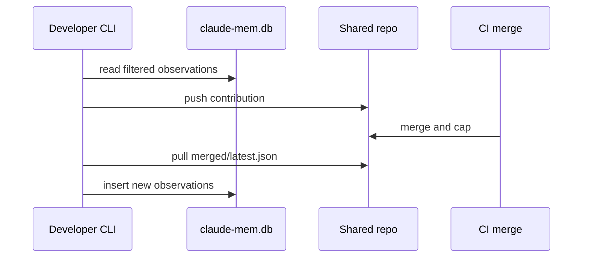

# Export and Import

## Motivazione

Export and import are explicit so developers control what leaves and enters their local memory database.

::: steps
1. **Preview:** `mem-sync preview --project my-app`
2. **Export:** `mem-sync export --project my-app`
3. **Wait for CI:** confirm `merged/my-app/latest.json`
4. **Import:** `mem-sync import --project my-app`
:::

::: callout tip "First rollout"
Use `remote.autoMerge: false` until filters and review policy are validated.
:::

## Incremental export

Each export writes only observations that are not already in your newest contribution file for that project. If nothing is new, no file and no commit is created, so scheduled exports stay quiet.

::: callout note "After the inbox is purged"
If CI has already deleted your last contribution file, the next export has nothing to compare against and writes your full filtered set once.
:::
